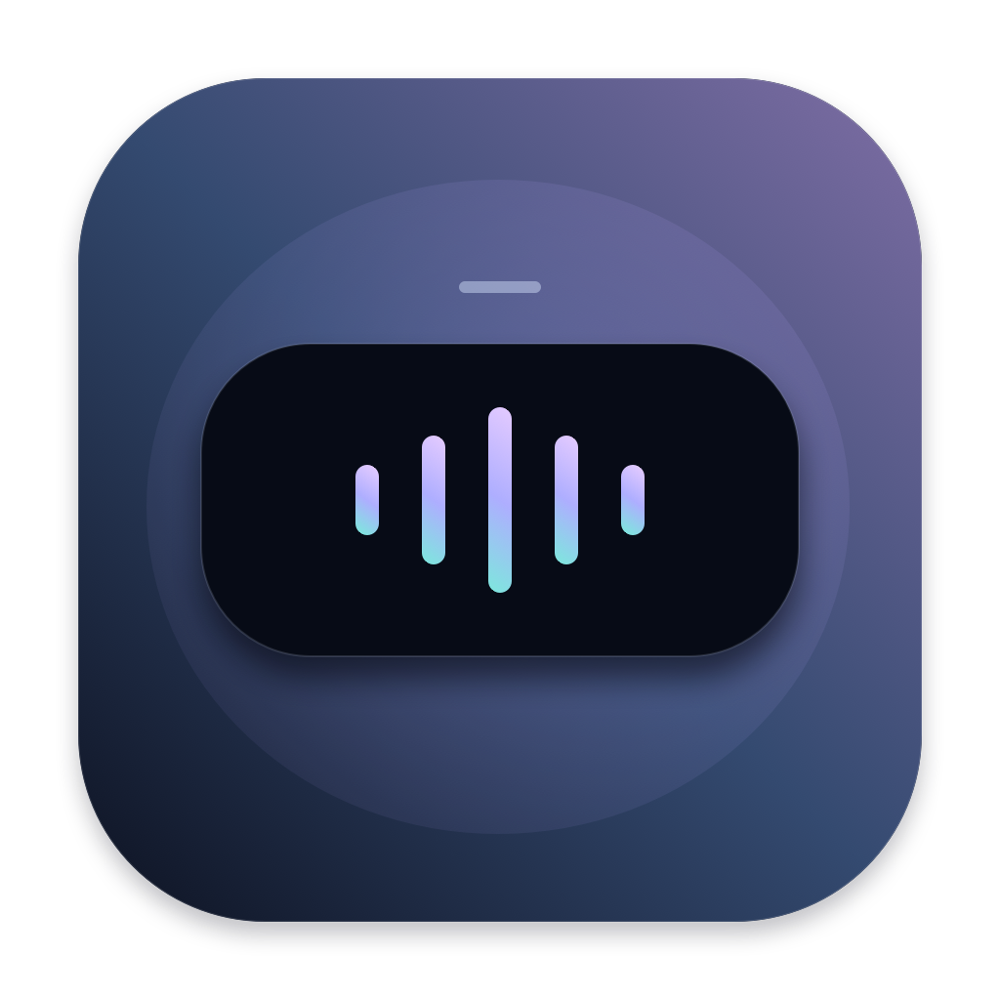
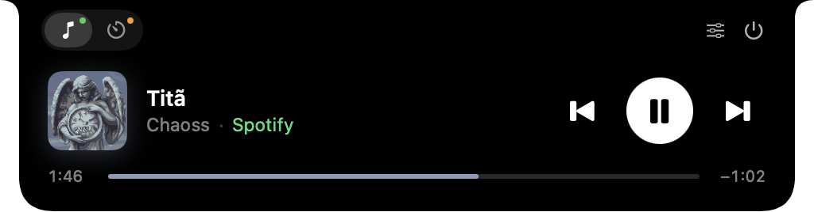
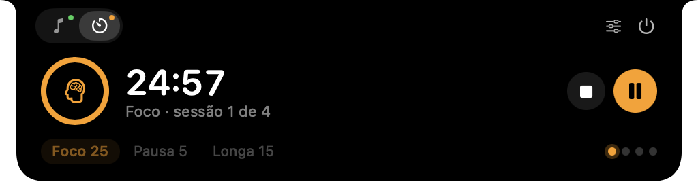
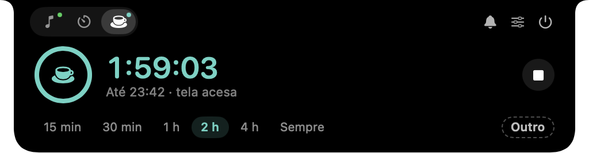
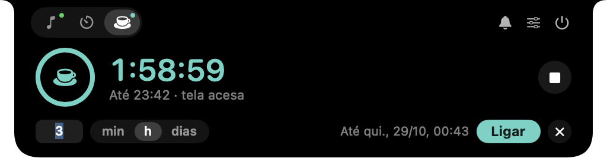
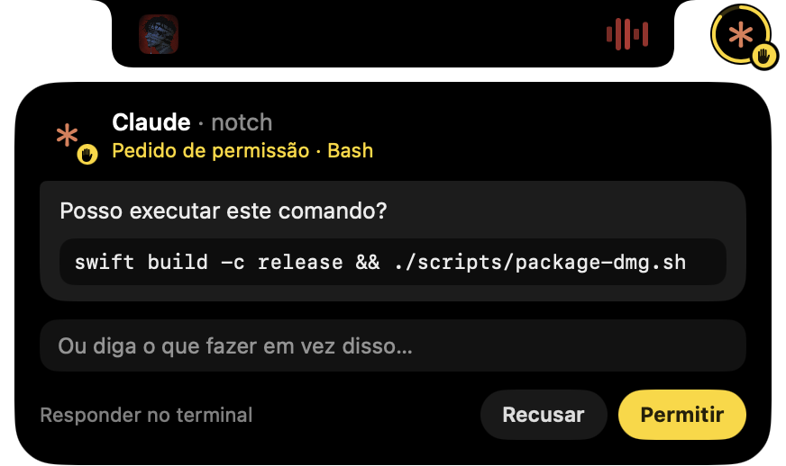
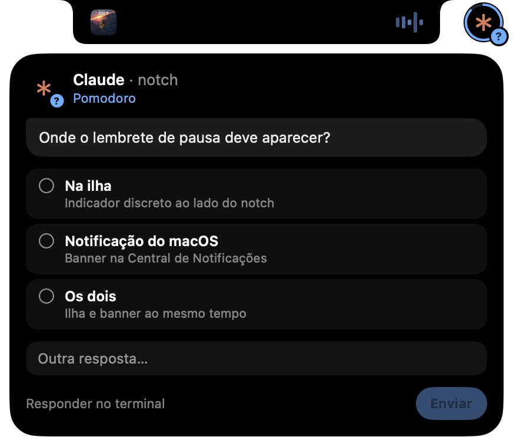

<div align="center">
  
  <h1>Notch</h1>
  <p><strong>Sua música e seu tempo, no lugar certo.</strong></p>
  <p>Uma ilha dinâmica para macOS, com controles de música, Pomodoro integrado e modo para manter o Mac acordado.<br>Discreta, personalizável e sem anúncios.</p>
  <p>macOS 14+ · Swift · SwiftUI + AppKit · Uso não comercial</p>
  <p>
    <a href="#por-que-criei-o-notch">A história</a> ·
    <a href="#em-funcionamento">Veja o app</a> ·
    <a href="https://github.com/ViniciusInTech/notch/raw/refs/heads/main/installers/Notch.dmg">Baixar para macOS</a> ·
    <a href="docs/SETUP.md">Configurar</a> ·
    <a href="CONTRIBUTING.md">Contribuir</a> ·
    <a href="DONATE.md">Apoiar via Pix</a>
  </p>
</div>

<p align="center">
  
</p>

## Por que criei o Notch

Eu queria acompanhar meus ciclos de Pomodoro e descobrir qual música estava
tocando sem precisar ficar trocando de janela. Queria algo que ficasse ali,
à mão, mas sem ocupar espaço o tempo inteiro.

A ideia foi trazer para o Mac uma experiência parecida com a ilha dinâmica
do iPhone: discreta enquanto eu trabalho e útil assim que passo o mouse.
Foi assim que nasceu o Notch, juntando música e tempo em um único lugar.

Decidi disponibilizar o código para outras pessoas estudarem, adaptarem para
uso pessoal e ajudarem a melhorar o app. Encontrou um bug, teve uma ideia ou
quer deixar alguma parte melhor? Abra uma issue ou envie um pull request.

## Em funcionamento

### Discreto quando precisa ser

<p align="center">
  
</p>

A ilha cresce só para os lados quando há atividade. Ao passar o mouse, abre
os controles a partir do notch; ao retirar, recolhe suavemente. Os encaixes
superiores acompanham o formato do recorte do Mac.

### Seu Pomodoro continua, sua música também

<p align="center">
  
</p>

Trocar entre Música e Pomodoro não interrompe a outra atividade. Quando os dois
estão ativos, a ilha recolhida mostra os indicadores na ordem em que começaram.

### Seu Mac acordado pelo tempo que você escolher

<p align="center">
  
</p>

A xícara, ao lado de Música e Pomodoro, impede o Mac de dormir: escolha um dos
atalhos, deixe sem limite ou toque em **Outro** para digitar um valor em
minutos, horas ou dias, sem sair da ilha.

<p align="center">
  
  &nbsp;
  
</p>

Recolhida, a ilha mostra a xícara pequena ao lado das ondas da música ou do
tempo do timer. Funciona como o `caffeinate` do macOS, sem processo extra, e
os atalhos ficam em **Configurações → Acordado**.

### Seus assistentes de código chamam sem tirar a música

<p align="center">
  
</p>

Quando o Claude Code ou o Codex precisam de você, surge uma bolinha ao lado da
ilha, como uma segunda atividade da Dynamic Island. O selo indica o tipo: mão
para permissão, interrogação para pergunta e balão para conclusão. O anel mostra
quanto tempo resta para responder pela ilha.

<p align="center">
  
  &nbsp;
  
</p>

Passe o mouse na bolinha para abrir um mini chat: permita, recuse, escreva o
que o assistente deve fazer em vez disso ou escolha uma das opções que ele
oferece. Enquanto o mini chat está aberto, nada muda sozinho.

*As imagens são capturas reais do aplicativo; as faixas e os tempos exibidos variam durante o uso.*

## O que o Notch faz

- **Música à mão:** capa, faixa, artista, reprodução, anterior/próxima e progresso.
- **Spotify sem conta extra:** integração com o app instalado, sem chave de API.
- **Navegador opcional:** mídia HTML5 da aba ativa do Safari ou Google Chrome.
- **Pomodoro configurável:** duração de foco e pausas, número de sessões por ciclo e início automático opcional.
- **Manter acordado:** impede o Mac de dormir por um tempo escolhido, sem limite ou por minutos, horas ou dias, como o `caffeinate`, sem processo extra.
- **Avisos de assistentes:** Claude Code e Codex pedem permissões, aprovação de planos e respostas pela ilha; Claude, Codex e Cursor avisam ao concluir.
- **Atividades simultâneas:** música e contagem continuam ao trocar de aba.
- **Ondas nas cores da capa:** animação decorativa, sem capturar ou analisar áudio.
- **Configurações nativas:** iniciar no login, reduzir movimento e som ao concluir.
- **Saída fácil:** botão Quit no próprio painel.

Sem anúncios, conta própria, telemetria, Electron ou servidor local. A prioridade
é manter uma experiência simples e discreta, com baixo consumo de recursos.

## Instalar

**[Baixar o instalador para macOS (.dmg)](https://github.com/ViniciusInTech/notch/raw/refs/heads/main/installers/Notch.dmg)**

[Opções de download e link direto](docs/DOWNLOAD.md)

**[Passo a passo: instalação, iniciar no login e permissões](docs/SETUP.md)**

O botão baixa o `.dmg` diretamente da pasta [`installers`](installers) deste
repositório, sem App Store. O arquivo de [checksums](installers/SHA256SUMS.txt)
permite conferir a integridade do download. Você também pode [compilar o app](#compilar-e-executar).

1. Abra o arquivo `.dmg` com dois cliques.
2. Arraste **Notch** para **Aplicativos**, como indica a janela.
3. Abra o Notch pelo Launchpad ou pela pasta **Aplicativos**.

> [!IMPORTANT]
> **“A Apple não pôde verificar se o Notch está livre de malware”**
>
> Esse aviso aparece porque o Notch não é **notarizado** pela Apple. A
> notarização exige o Apple Developer Program, que custa US$ 99 por ano, e o
> custo é o único motivo de ela ainda não existir aqui. O aviso não indica que
> algo suspeito foi encontrado no app.
>
> O Notch não contém vírus, anúncios nem telemetria, e todo o código está neste
> repositório para quem quiser revisar. Se preferir não confiar no instalador,
> confira o [SHA-256](installers/SHA256SUMS.txt) ou [compile o app](#compilar-e-executar) você mesmo.
>
> Para abrir na primeira vez:
>
> 1. Tente abrir o Notch e feche o aviso.
> 2. Vá em **Ajustes do Sistema → Privacidade e Segurança**.
> 3. Role até a mensagem sobre o Notch e clique em **Abrir Mesmo Assim**.
> 4. Confirme com sua senha ou Touch ID.
>
> Isso só é necessário uma vez por versão.

Se você abrir o Notch direto do `.dmg` ou de Downloads, ele oferece se mover
para Aplicativos sozinho, substituindo uma versão anterior e ejetando a imagem.
Conclua antes qualquer timer da versão anterior que queira preservar.

O app vive só no notch, sem ícone na barra de menus. Para iniciar com o Mac, abra as configurações pelo painel e
habilite **Iniciar ao fazer login** depois de instalá-lo em Aplicativos.
Se o macOS pedir aprovação, use **Abrir Itens de Início**. O [guia completo](docs/SETUP.md#2-faça-o-notch-iniciar-junto-com-o-login)
mostra como conferir esse registro nos ajustes do sistema.

O instalador atual foi preparado para Macs com Apple Silicon. O projeto requer
macOS 14 ou superior. Builds Intel ainda não foram validados.

## Permissões e integrações

### Spotify

Abra o Spotify e inicie uma faixa. Se o macOS solicitar, autorize o Notch a
controlá-lo em **Ajustes do Sistema → Privacidade e Segurança → Automação**.
Não é necessário conectar uma conta pela web ou fornecer credenciais ao Notch.

### Safari e Google Chrome

Habilite **Mídia do navegador** nas configurações e escolha a fonte. Além da
permissão de Automação, é necessário permitir JavaScript via Apple Events:

- **Chrome:** Visualizar → Desenvolvedor → Permitir JavaScript de Eventos da Apple.
- **Safari:** habilite os recursos para desenvolvedores e a opção JavaScript de Eventos da Apple.

A integração consulta apenas a aba ativa da janela frontal do navegador escolhido.
Funciona com elementos `audio` e `video` HTML5 do documento principal. Iframes,
DRM, abas em segundo plano e players personalizados podem não funcionar.
Anterior/próxima são oferecidos no Spotify e no player do YouTube.

Não há integração universal com todo áudio do Mac. O conteúdo das páginas,
histórico e credenciais não são enviados a servidores pelo Notch.

### Pomodoro

Por padrão são sessões de 25 minutos, pausas de 5 e pausa longa de 15 após quatro
sessões; tudo isso é ajustável em **Configurações → Timer**. Sem início automático,
cada etapa fica pronta para começar; com ele, foco e pausas se alternam sozinhos
até a pausa longa encerrar o ciclo.
Também há um temporizador com duração personalizada nas configurações.

A contagem considera o horário absoluto: se o Mac dormir, o aviso é apresentado
quando ele acordar. Fechar o aplicativo encerra a sessão atual do timer.

### Manter acordado

A aba com a xícara mantém o Mac acordado por 15 min, 30 min, 1 h, 2 h, 4 h, sem
limite ou por um valor em minutos, horas ou dias. Os atalhos, a duração do botão
Ligar, a tela apagar ou não e o corte com bateria abaixo de 20% ficam em
**Configurações → Acordado**. Fechar a tampa ainda coloca o Mac para dormir, e
sair do Notch encerra o período.

### Assistentes de código

Em **Configurações → Assistentes**, ative os avisos e instale o hook de cada
assistente. O hook é o comando local `notch-hook`, empacotado no app: não usa
tokens nem rede. Ele altera `~/.claude/settings.json`, `~/.codex/hooks.json` ou
`~/.cursor/hooks.json`, preservando outros hooks e guardando uma cópia
`.notch-backup`.

Com música ou timer ativos, o aviso aparece numa bolinha à direita da ilha; sem
outra atividade, ocupa as laterais da própria ilha. Passar o mouse abre o mini chat:

- **Permissão** (Claude Code e Codex): **Permitir**, **Recusar** ou escrever o
  que fazer em vez disso; o texto chega ao assistente junto com a recusa.
- **Plano:** ao sair do modo de planejamento, o plano aparece para **Aprovar** ou
  para pedir mudanças por texto.
- **Pergunta com opções:** escolha uma ou várias opções, ou escreva outra
  resposta. Uma pergunta única de escolha única é enviada no clique.
- **Conclusão** (Claude Code, Codex e Cursor): a última resposta aparece por
  alguns segundos. No Cursor, só há conclusão, porque o único hook de aprovação
  dele intercepta todo comando de terminal.
- **Nada muda enquanto você lê:** com o mini chat aberto, o prazo congela e
  nenhum outro aviso toma o lugar; uma escolha ou um texto em andamento o mantêm
  aberto até o envio. Sem resposta no prazo, ou em **Responder no terminal**, o
  pedido volta para o próprio assistente.
- **Pausar:** o sino do painel desativa os avisos, por exemplo ao compartilhar a
  tela. Pausado ou fechado, o Notch não recebe nada e os assistentes seguem como
  se o hook não existisse.

Reinstale os hooks se mover o Notch.app de lugar. No Codex, os hooks precisam
estar habilitados na versão instalada.

## Compilar e executar

Instale Swift 6 e as Command Line Tools (`xcode-select --install`) ou use o Xcode.

```sh
git clone git@github.com:ViniciusInTech/notch.git
cd notch
./scripts/test.sh
./scripts/build.sh
open dist/Notch.app
```

Para gerar o instalador com atalho para Aplicativos:

```sh
./scripts/package-dmg.sh
```

Para publicar sem o alerta de app não verificado, assine com Developer ID e
notarize: veja [docs/RELEASE.md](docs/RELEASE.md).

Você também pode abrir `Package.swift` no Xcode ou usar `./scripts/run.sh`.
Use o `.app` empacotado para testar Automação e iniciar no login, pois ele possui
a identidade final do aplicativo.

O empacotamento local usa assinatura ad hoc. A distribuição pública com
Developer ID e notarização exige configuração própria; o script não faz notarização.

## Como o projeto está organizado

| Pasta | Responsabilidade |
| --- | --- |
| `Sources/NotchCore` | Geometria, tempo, Pomodoro, manter acordado, ordem de atividades e cores das capas. |
| `Sources/Notch` | Interface nativa, painel, configurações e integrações. |
| `Sources/NotchHook` | `notch-hook`, ponte entre os hooks dos assistentes e o app. |
| `Tests/NotchCoreTests` | Testes das regras do app. |
| `Resources` | Ícone, identidade e permissões do aplicativo. |
| `scripts` | Compilação, criação do ícone e empacotamento. |
| `docs` | Capturas, arquitetura e verificações manuais. |
| `.github` | CI, template de PR e link de apoio. |

Leia a [arquitetura](docs/architecture.md) e a [verificação manual](docs/manual-testing.md)
para entender os limites das integrações e dos testes. Os scripts do CI verificam
o projeto e geram o artefato macOS; não publicam releases automaticamente.

## Consumo de recursos

As ondas usam cinco camadas de Core Animation, com preferência de 24 quadros/s
e máximo de 30. Param ao expandir a ilha, pausar a música ou habilitar Reduzir
Movimento. A cor é extraída uma vez por capa, fora da interface, e fica em cache.

O Spotify usa eventos de reprodução e reconciliação periódica enquanto está
aberto. O navegador só é consultado quando a integração está habilitada e ele
está aberto. As consultas param durante a suspensão do Mac; respostas de
automação não bloqueiam a interface. Capas têm limites de download e cache.

O consumo real varia conforme o Mac e as integrações ativas. Não há promessa de
uma porcentagem fixa de CPU ou memória.

## Contribua

Melhorias e correções são bem-vindas. Você pode abrir uma
[issue](https://github.com/ViniciusInTech/notch/issues), fazer um fork ou enviar
um [pull request](https://github.com/ViniciusInTech/notch/pulls).

Consulte o [guia de contribuição](CONTRIBUTING.md). O objetivo é evoluir o app
com simplicidade, acessibilidade e cuidado com os recursos do Mac.

## Apoie o projeto

Se o Notch for útil para você e quiser apoiar o desenvolvimento, pode fazer
uma doação voluntária por Pix. Qualquer valor é bem-vindo; usar o app e contribuir
não depende de pagamento.

<p align="center">
  <a href="DONATE.md"></a>
</p>

**[Ver a chave e o Pix Copia e Cola](DONATE.md)**

## Licença

O código está disponível sob a **[PolyForm Noncommercial 1.0.0](LICENSE)**.
Você pode estudar, usar, modificar e compartilhar para fins não comerciais,
mantendo a licença e os [avisos de autoria](NOTICE).

A licença não concede permissão para vender o app, vender versões modificadas
ou usar seu código em produtos ou serviços comerciais pagos. Alterar o nome,
o visual ou parte do código não remove essas condições.

Por conter restrição comercial, o projeto é descrito como **código disponível
para uso não comercial (source-available)**. O texto integral da licença define
as permissões e condições; este resumo não o substitui.
